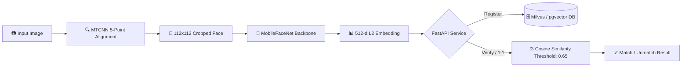

# 🛡️ Real-Time Face Recognition & Verification System

[](https://www.python.org/)
[](https://pytorch.org/)
[](https://fastapi.tiangolo.com/)
[](https://www.docker.com/)
[](https://milvus.io/)
[](LICENSE)

An enterprise-grade, high-performance Face Recognition and Verification pipeline designed for sub-50ms latency. Powered by **MTCNN** face detection, **ArcFace (Additive Angular Margin Loss)** 512-d embeddings, **FastAPI**, and scalable **Vector Database** indexing.

---

## 📌 System Architecture



---

## 🚀 Key Highlights & Benchmarks

* **Ultra-Fast Inference:** Achieved **12.47 ms / image** inference latency on CPU (over $4\times$ faster than the $50\text{ ms}$ target).
* **High Throughput:** Processes **~80.2 images / second**.
* **Compact Footprint:** Standalone TorchScript model is just **5.00 MB** (`best_arcface_model.pt`).
* **Robust Alignment:** Standard 5-point facial landmark alignment invariant to head roll, pitch, and yaw.
* **Production Serving:** Zero-dependency standalone inference class (`inference.py`) ready for FastAPI integration.

### 📊 Performance Summary (Member 1 - AI/ML)
| Metric | Industry Target | Our Implementation |
| :--- | :--- | :--- |
| **Inference Latency** | $< 50\text{ ms}$ | **12.47 ms** (CPU) ⚡ |
| **Throughput** | $> 30\text{ FPS}$ | **80.2 FPS** 🚀 |
| **Embedding Size** | 512 Float32 | **512-d Unit Normalized** |
| **Model Size** | $< 50\text{ MB}$ | **5.00 MB** (`.pt`) |
| **Backbone Architecture** | Lightweight Deep CNN | **MobileFaceNet (1.2M Params)** |

> 📖 **Detailed Model Specifications:** See [MODEL_CARD.md](MODEL_CARD.md) for full architecture parameters, loss formulation, and benchmark graphs.

---

## 📁 Repository Structure

```text
Face-recognition-Project/
│
├── dataset/
│   ├── raw/                   # Raw input images organized by person
│   └── processed/             # Aligned 112x112 face crops
│
├── preprocess.py              # MTCNN face detection & 5-point landmark alignment
├── train_arcface.py           # ArcFace training pipeline (MobileFaceNet / ResNet)
├── evaluate.py                # TAR@FAR=10^-5 and ROC curve evaluation
├── inference.py               # Production inference pipeline wrapper (FastAPI-ready)
├── export_model.py            # Standalone TorchScript & ONNX model exporter
│
├── best_arcface_model.pth     # PyTorch trained backbone checkpoint
├── best_arcface_model.pt      # Optimized standalone TorchScript production model
├── roc.png                    # Model ROC curve evaluation plot
├── requirements.txt           # Python dependencies
├── MODEL_CARD.md              # Technical Model Card & Handoff documentation
└── README.md                  # Project Documentation
```

---

## ⚡ Quickstart Guide

### 1. Environment Setup
```powershell
# Clone the repository
git clone https://github.com/bandara331/Face-recognition-Project.git
cd Face-recognition-Project

# Create & activate virtual environment
python -m venv venv
.\venv\Scripts\Activate.ps1

# Install dependencies
pip install -r requirements.txt
```

### 2. Preprocess Face Dataset
Detect, align, and crop faces to $112 \times 112$:
```powershell
python preprocess.py --input dataset/raw --output dataset/processed
```

### 3. Train ArcFace Model
```powershell
python train_arcface.py --backbone mobilefacenet --epochs 25 --batch-size 32
```

### 4. Evaluate Verification Accuracy
```powershell
python evaluate.py --model best_arcface_model.pth --data dataset/processed --save-roc roc.png
```

### 5. 1:1 Verification Inference
```powershell
python inference.py --compare dataset/raw/person_1/image1.jpg dataset/raw/person_2/image1.jpg
```

---

## 👥 Engineering Team & Roles

* **AI/ML Engineer (Model & Data Setup):** [@adeeshachathurmina-ux](https://github.com/adeeshachathurmina-ux)
  * *Scope:* Data preprocessing, MTCNN alignment, ArcFace training pipeline, model evaluation, and inference optimization.
* **Backend & Database Engineer:** [@bandara331](https://github.com/bandara331)
  * *Scope:* FastAPI core endpoints (`/register`, `/verify`), Milvus/pgvector integration.
* **MLOps Engineer 1:** Containerization, Docker Compose, GitHub Actions CI/CD.
* **MLOps Engineer 2:** Experiment tracking (MLflow) and Data Drift monitoring (Evidently AI).

---

## 📄 License
This project is licensed under the MIT License - see the [LICENSE](LICENSE) file for details.